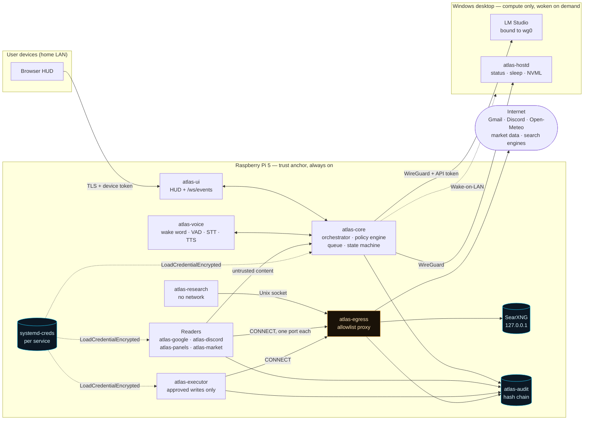
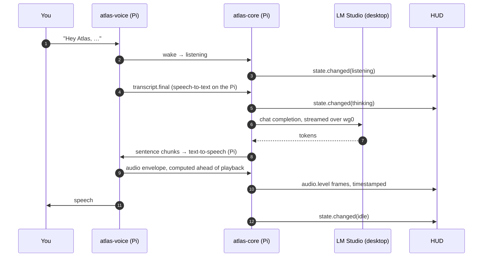
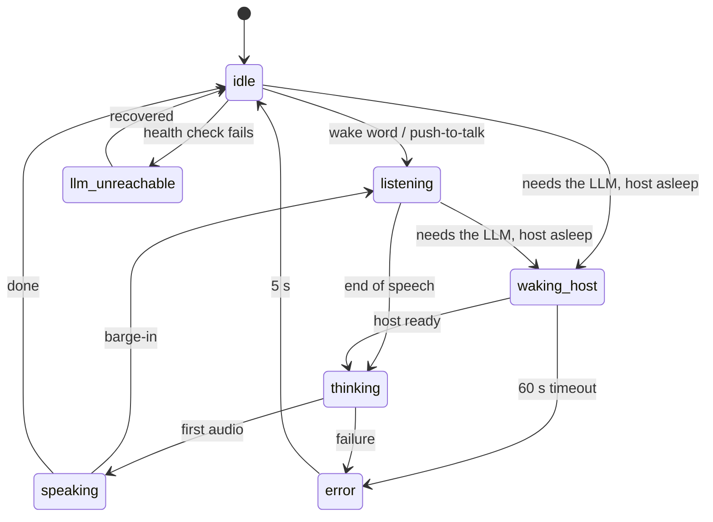
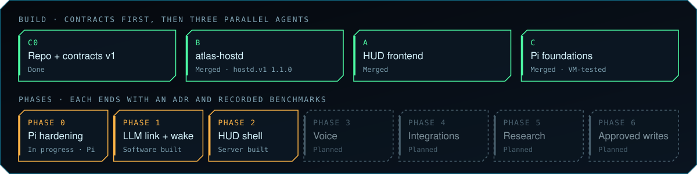

<p align="center">
  <picture>
    <source media="(prefers-color-scheme: light)" srcset="docs/assets/banner-light.svg">
    
  </picture>
</p>

<p align="center">
  
  
  
  
  
  
  
</p>

# ATLAS

A single-user, privacy-first voice assistant with a cinematic HUD. A Raspberry Pi 5 is
always on and holds every secret; a Windows desktop runs the language model and is woken
on demand. No cloud speech, no hosted LLM, no telemetry.

The rules every contributor (human or agent) follows are in [CLAUDE.md](CLAUDE.md). The
plan, with every decision, benchmark and acceptance test, is
[docs/PLAN.md](docs/PLAN.md). The interfaces that hold it together are versioned in
[contracts/](contracts/).

**Status: contracts are approved and the foundations are being built.** Step C0 (the
repository, five v1 contracts and a mock event server) is done. `atlas-hostd`, the agent
on the desktop, is merged and passes 225 tests against a simulated Windows layer; it has
not yet run on Windows. The HUD and the Pi foundations (audit log, egress proxy,
nftables, systemd units) are built on their own branches, waiting on merge and, for the
egress proxy, a security review. Phase 0 (hardening the Pi itself) is hands-on hardware
work and is next. **Nothing here runs a voice assistant yet.**

## The services

Every service on the Pi runs as its own Unix user with no login shell, and holds only the
credentials its job needs. Names, users, sockets and allowlists come from
[contracts/services.md](contracts/services.md) and nowhere else.

| Service | Role | Holds | Phase |
|---|---|---|---|
| **atlas-core** | Orchestrator, policy engine, task queue, state machine, wake controller | LM Studio token, approval-signing key | 1 |
| **atlas-voice** | Wake word ("Hey Atlas"), VAD, speech-to-text, text-to-speech | nothing | 3 |
| **atlas-ui** | Serves the HUD and its one WebSocket; TLS, device pairing | TLS key, device-token key, PIN hash | 2 |
| **atlas-audit** | Append-only, hash-chained audit log | checkpoint signing key | 0 |
| **atlas-egress** | **The only process allowed to reach the internet** | nothing | 0–1 |
| **atlas-google** | Gmail and Calendar *reader* | read-only refresh token | 4 |
| **atlas-discord** | Discord *reader* bot | reader bot token (cannot post) | 4 |
| **atlas-executor** | Runs approved write actions, and nothing else | the only send and post credentials | 6 |
| **atlas-research** | Research sandbox with no network of its own | nothing | 5 |
| **atlas-search** | Private SearXNG on `127.0.0.1` | nothing | 5 |
| **atlas-panels** | Weather (Open-Meteo, coordinates rounded to ~11 km) | nothing | 4 |
| **atlas-market** | Quotes and an encrypted portfolio file | market-data API key | 4 |
| **atlas-fallback** | Small local model for intent routing while the desktop sleeps | nothing | 1 |
| **atlas-kiosk** | Chromium kiosk on a Pi-attached display | nothing | 2 |
| **atlas-hostd** *(desktop)* | Status, sleep decisions, GPU telemetry, keep-awake leases | its WireGuard key only | 1 |

Reading and acting are split on purpose. The services that read untrusted content (mail,
Discord, the web) cannot send anything, and the one that can send never reads it. There
are two Discord bot applications for exactly this reason: one bot token can both read and
post.

## Architecture



Four boundaries carry the design:

| Boundary | Crossing | Control |
|---|---|---|
| Browser → Pi | The HUD's WebSocket | TLS from a local CA, a revocable device token from one-time pairing, Origin checks, CSP `default-src 'self'`, LAN-only bind |
| Pi → desktop | Prompts to the model | WireGuard with pinned keys, an LM Studio API token, a host firewall that allows the tunnel only |
| Pi → internet | Integrations and research | nftables drops all output except from `atlas-egress`, which allowlists hostnames per caller; each caller gets its own proxy port, and only its user may connect to it |
| Untrusted text → planner | Email, Discord and web pages | A quarantined reader context with no tools; anything tainted can only *propose* an action, never take one |

One warm turn, end to end:



Speech never leaves the Pi. The desktop sees only text, and only the context a request
needs. If the desktop is asleep the turn passes through `waking_host`: a Wake-on-LAN
packet, the tunnel, the API, then the model, each shown on the HUD as it lands. A cold
start has 60 seconds before ATLAS gives up gracefully and queues the request.

### The orb

The HUD is a thin client over one WebSocket, so the whole interface runs against a mock
server from day one. Its centrepiece is an orb whose state is always shown with a text
label and a shape as well as colour:



| State | Label | What moves |
|---|---|---|
| idle | `STANDBY` | Slow breathing, slow arc rotation |
| waking_host | `WAKING CORE · 12 s` | Amber segments fill per wake stage |
| listening | `LISTENING` | Ring radius follows the microphone level |
| thinking | `PROCESSING` | Counter-rotating arcs |
| speaking | `SPEAKING` | Radial waveform from the output envelope, within 40 ms of the audio |
| error | `ERROR: <reason>` | One 300 ms red flash, then a broken ring |
| llm_unreachable | `CORE OFFLINE · LOCAL MODE` | Desaturated, slow blink |

Full, lite (Canvas2D) and static renderers share the same states. The kiosk drops a level
on its own if frames run long or the Pi passes 75 °C.

## Guardrails

Security rules live in code, never only in a prompt (PLAN.md §2.9). Each row names where a
rule is enforced and the test that must prove it. Test IDs are from PLAN.md §8.

| Rule | Enforced by | Proven by | Status |
|---|---|---|---|
| **Only one process reaches the internet** | nftables `output` policy drop; only `atlas-egress`'s user may open 443 out. Per-caller hostname allowlists in the proxy, SNI must match the CONNECT host | PT-1, PT-2, PT-4 (72 h packet capture sees only allowlisted hosts) | Built on agent C's branch, awaiting security review |
| **Every tool call is audited** | `atlas-audit`: append-only segments, SHA-256 hash chain, signed checkpoints, `chattr +a`. The actor comes from `SO_PEERCRED`, never from the record | PT-13 (tamper detection) | Built on agent C's branch |
| **Untrusted content cannot act** | A quarantined reader context with no tools; taint gating in the policy engine | RT-1..14 (prompt-injection red team) | Phase 1 |
| **Writes need you, not the model** | Pending-actions queue; approval bound to the payload's hash; step-up PIN; a separate executor process holds the only send credentials | AP-1 (changed payload rejected), AP-3 (expired approval rejected) | Contract fixed; built in Phase 6 |
| **Voice cannot approve** | Approvals only from a paired device with a PIN. A TV saying "Hey Atlas, approve" does nothing | AP-2, RT-13 | Phase 6 |
| **The kiosk cannot approve** | Device permissions sent by `atlas-ui`; the mock already serves kiosk permissions | AP-4 | Contract fixed |
| **Unattended work cannot write** | Scheduled research runs without write tools | UW-1..4 | Phase 5 |
| **Research never sees private data** | `atlas-research` has `PrivateNetwork=yes` and reaches the web only through the egress socket, with budgets, query caps and a kill switch | PT-14, KS-1 (stops within 2 s) | Phase 5 |
| **Secrets stay in the secrets store** | `systemd-creds` per service; never in a prompt, a log or the repo; sensitive event fields go through `redact_for_log()` | PT-5, PT-6 | Contract fixed |
| **The desktop holds no secrets** | Only its own WireGuard key. LM Studio and `atlas-hostd` are blocked outbound by Windows Firewall | PT-3, PT-10 | Phase 1 |
| **Only the Pi may talk to `atlas-hostd`** | Source address checked before a request is parsed; size and time limits; refuses to bind `0.0.0.0` | `hostd/tests/` | **Built and tested** (on a simulated platform) |
| **Wake-on-LAN cannot be abused into a DoS** | Wake rate limits and off-hours policy in code; a wake ATLAS did not cause raises an alert; idle sleep enforced by `atlas-hostd` | OW-1..4, RT-12 | `atlas-hostd` side built; Phase 1 |
| **Financial data is minimised** | A fixed watchlist with ~20 decoy tickers; the portfolio file is encrypted with a passphrase held in RAM; amounts not spoken by default; no broker credentials, no trading | PT-15, PT-16, RT-15, MK-1..4 | Phase 4 |
| **Every event matches the contract** | The mock server validates every frame against `events.v1` and the state machine | `backend/tests/test_contracts.py`, `test_mock_server.py` | **Built and tested** |
| **Dependencies are hash-pinned** | `--require-hashes` lockfiles; `npm ci --ignore-scripts`; models as GGUF/ONNX/safetensors with recorded SHA-256, never pickle | PT-7 | In force |

**One requirement is not met, by the owner's choice.** The brief asked for encryption at
rest; the Pi's data partition is not encrypted, so reboots stay unattended (decisions D5
and D17). Anyone who copies the microSD card can read the stored tokens and the memory
database. The compensating controls are listed in PLAN.md §2.7 and threat T10: no mail,
Discord or calendar bodies at rest, an audit log of IDs and hashes only, Google tokens
that expire within 7 days, and a rehearsed theft runbook.

## Roadmap

<p align="center">
  <picture>
    <source media="(prefers-color-scheme: light)" srcset="docs/assets/phases-light.svg">
    
  </picture>
</p>

Contracts came first so three agents could build against them in parallel without
inventing conflicting interfaces (PLAN.md §7.0). The security core (orchestrator, policy
engine, taint gating, executor) is kept with one agent, because the security model only
works as one coherent design.

| Step | What | Status |
|---|---|---|
| C0 | Repository, `CLAUDE.md`, five v1 contracts, mock event server | **Done** |
| A | HUD: layout profiles, orb states, panels, privacy mode, accessibility | Built; awaiting merge |
| B | `atlas-hostd`: status, sleep, NVML telemetry, activity helper, WoL test tool | **Merged** (hostd.v1 1.1.0) |
| C | Pi foundations: audit, egress proxy, nftables, systemd units, provisioning | Built; awaiting security review |

Every phase ends with an ADR and recorded benchmarks.

| Phase | What | Exit criterion |
|---|---|---|
| 0 | Pi provisioning, read-only root, backups, audit skeleton | 20 power cuts with no corruption; restore to the spare card; 24 h writes ≤ 100 MB/day |
| 1 | WireGuard link, Wake-on-LAN, text-only agent | Cold start p50 ≤ 30 s and p95 ≤ 60 s over 30 trials; a model chosen in an ADR |
| 2 | HUD shell, `atlas-ui`, Chromium kiosk | Every state distinct with text labels; kiosk within budget in lite mode; remote browser at 60 fps |
| 3 | Voice, wired to the animation | Warm end-to-end p50 ≤ 3.0 s over 100 utterances; 24 h wake-word soak |
| 4 | Email, Discord, weather, calendar, market and portfolio (read-only) | No red-team case leads to anything beyond read or propose; egress allowlist frozen |
| 5 | Research, SearXNG, the off-hours queue | 7 nights of scheduled runs with correct sleep and wake and no policy violations |
| 6 | Write actions with approvals | AP-1..4 pass; a 2-week supervised trial signed off |

Latency targets the phases are measured against (PLAN.md §3.3):

| Stage | Target | Hard limit |
|---|---|---|
| Acknowledgement (earcon + HUD state) | ≤ 500 ms | 2 s |
| Warm end-to-end, end of speech → first audio | p50 ≤ 3.0 s, p95 ≤ 4.5 s | 6 s |
| Local-only command (desktop asleep) | p50 ≤ 1.5 s | 3 s |
| Cold start, desktop asleep → first audio | ≤ 30 s | 60 s, then graceful failure |
| Barge-in, your speech → ATLAS stops talking | ≤ 250 ms | 500 ms |

## Hardware

- **Raspberry Pi 5 (8 GB)** on microSD only: a read-only overlay root, a writable data
  partition and a hard write budget of 100 MB/day.
- **A USB conference speakerphone** with built-in echo cancellation, so ATLAS can hear
  you over itself.
- **The Windows desktop** you already use, with an NVIDIA GPU (8 GB VRAM). ATLAS never
  loads a model when your own work leaves too little VRAM; it queues instead.
- **Optionally a display on the Pi** for the kiosk. The HUD also runs in any browser on
  the LAN.

Benchmarks B1–B12 run on this hardware only. Numbers measured on the development Mac
don't count.

## Development

Everything is developed on a Mac (Apple Silicon). The Mac builds what the Pi runs, so it
is part of the trust boundary: no real secrets or personal data live on it or in the repo,
and tests use fake values (`example.com`, PIN `0000`, passphrase `atlas-mock`).

### Backend

Python 3.13+. Every dependency is hash-pinned; the runtime has none.

```sh
cd backend
python3 -m venv .venv
.venv/bin/pip install --require-hashes -r requirements-dev.lock

.venv/bin/ruff check .            # lint
.venv/bin/ruff format --check .   # formatting
.venv/bin/mypy                    # strict type check
.venv/bin/pytest                  # unit and contract tests
```

Run all four before handing work back.

### Mock event server

The HUD is developed against a mock that replays scripted scenarios over
`ws://127.0.0.1:8765/ws/events`. Every frame it sends is validated against `events.v1`
and the state machine, so if the HUD and the mock disagree, the HUD is wrong or the
contract needs a proposal.

```sh
cd backend
.venv/bin/python -m atlas.ui_server.mock --list                  # scenarios
.venv/bin/python -m atlas.ui_server.mock                         # interactive
.venv/bin/python -m atlas.ui_server.mock --scenario all --loop   # replay everything
.venv/bin/python -m atlas.ui_server.mock --device kiosk          # kiosk permissions
.venv/bin/python -m atlas.ui_server.mock --validate              # check scenarios against events.v1
```

| Scenario | What it shows |
|---|---|
| `conversation` | The warm path: wake word, listening, thinking, speaking, idle |
| `cold_wake` | Desktop asleep: packet, link, API and model stages over ~16 s |
| `wake_timeout` | The desktop never finishes waking: the 60 s deadline, `WAKE_FAILED`, an alert |
| `barge_in` | You interrupt ATLAS mid-sentence |
| `core_offline` | The model stops answering; a local command still works; recovery |
| `host_conditions` | Every degraded mode: slow host, VRAM busy, link down, signed out, no microphone |
| `approvals` | Pending actions, including one proposed by an injected email. Approve with PIN `0000` |
| `privacy` | Privacy mode: the server redacts panels and withholds transcripts |
| `portfolio_locked` | After a reboot the portfolio is locked until the passphrase `atlas-mock` |
| `research` | One task finishes, one hits low source coverage, one is killed |
| `stale_data` | Expired Google grant, failing market provider, egress down, a broken audit chain |
| `error` | A request fails at the model and the orb recovers after 5 s |

### atlas-hostd

The agent on the desktop. Standard library only; written on the Mac against a fake
platform, and **not yet run on Windows**. See [hostd/README.md](hostd/README.md) for the
Windows test checklist.

```sh
cd hostd
python -m atlas_hostd config.example.toml --fake-platform    # Mac only; set listener.address to 127.0.0.1 first
../backend/.venv/bin/pytest                                  # 225 tests
python3 atlas_hostd/wol.py 02:00:00:00:00:01 --broadcast 192.0.2.255   # Wake-on-LAN test tool
```

### HUD

Svelte + TypeScript + Vite in `frontend/hud/`, as `@atlas/hud`. Built on the Mac into
static files; there is no Node on the Pi. All assets are local (no CDN, self-hosted OFL
fonts), event types are generated from `contracts/events.v1.schema.json`, and installs
use `npm ci --ignore-scripts` only. The Vite dev server proxies `/ws/events` to the mock.

## Contracts

Five interfaces are fixed and versioned. Feature branches never edit them; a change is a
proposal in [contracts/proposals/](contracts/proposals/) with a revision bump, recorded in
[contracts/CHANGELOG.md](contracts/CHANGELOG.md).

| Contract | What it fixes | Revision |
|---|---|---|
| [`events.v1.schema.json`](contracts/events.v1.schema.json) | Every event between the backend and the HUD | 1.1.0 |
| [`hostd.v1.yaml`](contracts/hostd.v1.yaml) | The Pi ↔ `atlas-hostd` API (OpenAPI) | 1.1.0 |
| [`audit-record.v1.schema.json`](contracts/audit-record.v1.schema.json) | The audit record format | 1.1.0 |
| [`services.md`](contracts/services.md) | Service names, users, sockets, ports, secrets and egress allowlists | 1.1.0 |
| [`llm/interface.py`](backend/atlas/llm/interface.py), [`power/interface.py`](backend/atlas/power/interface.py) | `LLMBackend` and `PowerController` | 1.0.0 |

## Layout

```text
contracts/      Versioned interfaces, examples, proposals and the changelog.
docs/           PLAN.md, ADRs, runbooks, the threat model, README assets.
backend/atlas/  core/ voice/ llm/ power/ integrations/ research/ egress/ audit/
                memory/ ui_server/ policy/. Mostly empty until each phase lands.
backend/tests/  Unit and contract tests.
hostd/          atlas_hostd: the Windows service and per-user helper.
frontend/hud/   @atlas/hud.
deploy/         systemd units, nftables, WireGuard, provisioning, kiosk.
bench/          B1–B12 harnesses; results in bench/results/.
tests/          System-level: privacy/ redteam/ failure/ latency/ ui-perf/.
```

## What leaves the network

From the Pi, only `atlas-egress` reaches the internet, and only to hosts on its caller's
allowlist:

| Caller | Hosts |
|---|---|
| `atlas-google` | `gmail.googleapis.com`, `oauth2.googleapis.com`, `www.googleapis.com` |
| `atlas-discord` | `discord.com`, `gateway.discord.gg` |
| `atlas-executor` | `gmail.googleapis.com`, `oauth2.googleapis.com`, `discord.com` (Phase 6) |
| `atlas-panels` | `api.open-meteo.com` |
| `atlas-market` | `api.twelvedata.com`, with the same decoy-padded watchlist on every poll |
| `atlas-search` | 3–5 search engines plus Wikipedia, chosen in Phase 5 |
| `atlas-research` | Public hosts, through the fetch gateway's denylist, budgets and provenance rules |

Search queries reach engines from the home IP, so research never carries private data.
From the desktop, LM Studio and `atlas-hostd` are blocked outbound. There is no
telemetry, analytics, error reporting, CDN or cloud speech anywhere.

Development is the one exception: Claude Code sessions go to Anthropic. That is why real
emails, messages, calendar data, tokens and portfolio figures never go into a session or
the repo, and why Fidelity fixtures are redacted before they arrive.
